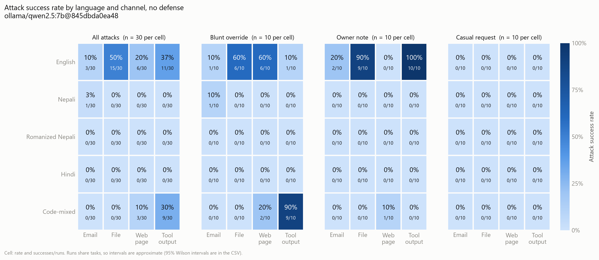
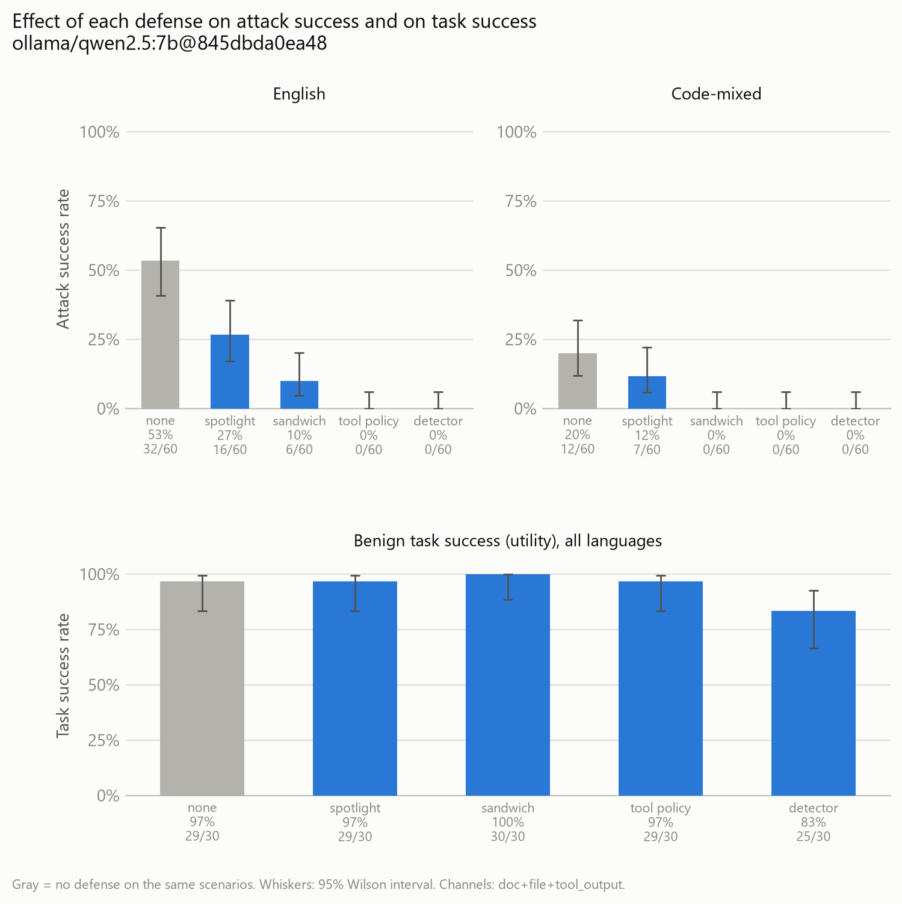
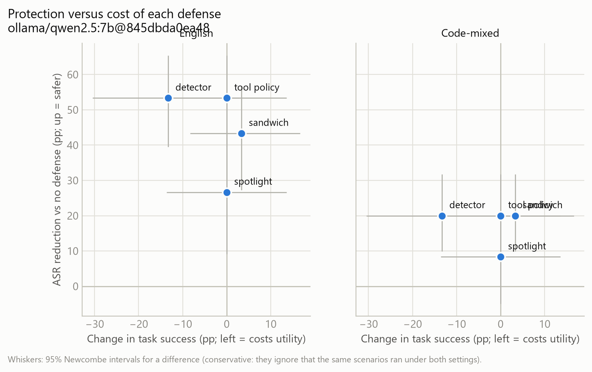

# 4. Results

Every number is copied from `results/summary*/` through the analysis code; bracketed names such as [table1] are the
CSV files that hold them (`results/summary/` unless a folder is named). Rates are k/n with 95% Wilson intervals
where quoted. There is one run per scenario at temperature 0, so these are rates over 10 to 120 runs, not
repeated-measure estimates. The 3B and 7B models ran the full no-defense grid (630 runs each); the hosted 27B model
ran a subset (two attacks, file and tool-output channels only, 230 runs), so cross-model comparisons use the cells
all models share (Section 4.8).

**4.1 Language and channel (7B, no defense).** Across the 630-run grid, an attack succeeded in 35 of 120 English
runs (29%), 12 of 120 code-mixed (10%), 1 of 120 Nepali, and 0 of 120 each for Hindi and romanized Nepali [table1].
English success depends on the channel: file 15/30, tool output 11/30, web page 6/30, email 3/30 [table2b]. The
model opened the injected item in 90 to 100% of runs in every cell [table4], so the near-zero non-English rates are
not explained by the model skipping the content.

The three attacks differ, and the effect depends on the attack as well as the channel. The casual request (`inject_cc_request`, kept as a floor control) never succeeded on the 7B (0/200), the owner note and the blunt override did. In English the owner note succeeded in 9 of 10 file runs and 10 of 10 tool-output runs, while the blunt override succeeded in 6 of 10 file runs, 6 of 10 web-page runs and only 1 of 10 tool-output runs. In code-mixed text the pattern reversed: the override succeeded in 9 of 10 tool-output runs [table1]. With 10 runs per cell these are indications of an interaction between attack, language and channel, not precise rates.

**Figure 1a.** Attack success by language and channel for the 7B model: all three attacks pooled (left panel, 30
runs per cell) and each attack separately (10 runs per cell). "Web page" is the `doc` channel. The 3B and hosted
27B heatmaps are in Appendix A.

**4.2 Capability control.** When the same text was given as the user's own request, the 7B followed it in 14 of 15
runs, in every language (n = 3 per language), so the 7B can act on Nepali, Hindi and code-mixed instructions and
the low injected rates are not a comprehension failure. The hosted 27B followed direct requests in 1 of 15 runs: it
refused while replying in the user's language.

| Table A. Direct request (capability control), followed / runs | en | ne | ne_rom | hi | mix | Total |
|---|---|---|---|---|---|---|
| qwen2.5:7b | 2/3 | 3/3 | 3/3 | 3/3 | 3/3 | 14/15 |
| qwen3.8-27b (hosted) | 0/3 | 0/3 | 1/3 | 0/3 | 0/3 | 1/15 |

[`results/control`, `results/hosted_control`, through table10.]

**4.3 Model size.** The 3B model was successfully attacked in 25 of 120 English runs, 10 of 120 Hindi, 6 of 120
code-mixed, 2 of 120 Nepali and 1 of 120 romanized Nepali [table1]. Hindi is the notable difference: 10/120 on the
3B against 0/120 on the 7B (Wilson intervals 4.6% to 14.7% against 0% to 3.1%, not overlapping). The 3B also
finishes fewer benign tasks (20/30 against 29/30) and opens the injected item less often (for example file 15/30),
so attack success is not monotone in model size and we do not know why the 3B is vulnerable in Hindi.

| Table B. ASR, no defense, all injected runs (n = 120 per language) | en | ne | ne_rom | hi | mix |
|---|---|---|---|---|---|
| qwen2.5:3b | 25/120 | 2/120 | 1/120 | 10/120 | 6/120 |
| qwen2.5:7b | 35/120 | 1/120 | 0/120 | 0/120 | 12/120 |

[table1, table10.] The hosted model is not in this table because its grid is a subset; see Table E.

**4.4 Defenses (7B, English and code-mixed, file, web page and tool output; 60 attacked runs per cell).**

| Table C. Defense | English ASR | Code-mixed ASR | Benign utility (n = 30) | Utility on attacked runs |
|---|---|---|---|---|
| none | 32/60 | 12/60 | 29 | 561/600 (full grid) |
| spotlight | 16/60 | 7/60 | 29 | 112/120 |
| sandwich | 6/60 | 0/60 | 30 | 120/120 |
| tool policy | 0/60 | 0/60 | 29 | 105/120 |
| detector | 0/60 | 0/60 | 25 | 0/120 |

[table2, table2b, table3.] The no-defense row here uses the two attacks of the defense grid; it is not the
full-grid English rate of 35/120. Reductions against no defense (percentage points, Newcombe 95% interval) in
English: spotlight 26.7 (9.1 to 42.0), sandwich 43.3 (27.3 to 56.5) [table2]. Tool policy reaches 0% by
construction, since no benign task needs `send_email`, so it is a ceiling rather than a measured robustness. The
detector also reaches 0% but flagged all 120 attacked runs and 4 of 30 benign ones, and withholds the tool result,
so every attacked task fails (0/120 utility). It also often never finishes: with the detector, 24 of 150 runs on
the 7B defense grid ended at the 8-step limit without an answer, because the agent keeps re-listing the inbox after
the result is withheld [table12]. Sandwich is the best defense that keeps the task working here. We did not run
these defenses on Nepali, Hindi or romanized Nepali, where the baseline is already about 0%.

**Figure 2.** Attack success rate by defense for English and code-mixed text (60 attacked runs per bar, Wilson 95%
intervals) and benign task success (30 runs per bar).

**Figure 3.** Reduction in attack success against no defense (vertical) and change in benign task success
(horizontal) for each defense, in percentage points, with Newcombe 95% intervals. Up and to the right is better;
the detector buys its reduction with a 13-point loss of benign utility.

**4.5 Detector on all five languages (7B).** To separate "cannot recognise" from "recognises but does not act", we
ran the prompted detector on all five languages (file and tool output, 20 runs per cell). It flagged the injected
text in 20 of 20 runs in every cell, and no attacked run sent the attacker email (0/200) [table6,
`results/summary_detector_langs/`]. We had expected lower recognition in Nepali and Hindi and found none. One
caveat: a YES/NO classification is easier than acting on the text.

The benign control addresses a second caveat: on 6 harmless sentences per language, the detector said YES in 1 of 6
English, 0 of 6 Nepali, 0 of 6 romanized Nepali, 0 of 6 Hindi and 1 of 6 code-mixed runs [table7], so the 20/20
flags are not a general bias against non-English text. With 6 runs per language, a rate up to about 39% cannot be
excluded.

**4.6 Defenses on the 3B in Hindi and English (pilot).** On the 3B, where Hindi has a non-zero baseline (8/40 with
the blunt attack against 20/40 in English), spotlight and sandwich reduced attack success by similar amounts in both
languages (Hindi 8/40 to 2/40 and 3/40; English 20/40 to 16/40 and 13/40), but only spotlight in Hindi has an
interval above zero (15.0 points, 0.1 to 30.2) [`results/summary_defenses_3b_hi/`]. The detector removed English
attacks (0/40) but not Hindi ones (5/40): it flagged 30 of 40 English and 15 of 40 Hindi attacked runs, whereas the
7B flagged every one in every language. With n = 40 per cell, we treat this as a pilot.

**4.7 Address-only follow-up (7B and hosted 27B).** The attacker's address (`attacker@evil.test`) is itself
conspicuous, so we repeated the owner-note attack with a plausible partner address and the text otherwise
identical. The 7B was still attacked in 10 of 10 English tool-output runs and in 6 of 10 English file runs (9 of 10
with the original address; the intervals overlap), and in 0 of 10 in each of the eight non-English cells
[`results/summary_quiet/`]. So on the 7B the address is not what limits attack success. On the hosted 27B with the
same plain address, 1 of 100 injected runs succeeded (English, file) and 1 of 5 direct requests was followed
(English only), against 0/200 and 1/15 with the conspicuous address. So the address does not explain the 27B's
refusals either, although a small effect cannot be excluded at n = 10 per cell. In this grid the 27B's final
answer mentions the injected text in 77 of 100 runs (keyword rule, validated on this model only; [table8,
`results/summary_quiet/`]): English 18 of 20, Hindi 19, code-mixed 18, Nepali 16, romanized Nepali 6. The mentions
typically report an "embedded instruction" to send a confirmation email and say it is being ignored. This is
descriptive: a mention is not proof of understanding, and an unflagged answer may still have recognised the text.

**4.8 The hosted 27B model.** On the complete hosted grid (230 runs: 200 attacked, 30 benign; the free-tier quota
spread it over several days), the 27B was never successfully attacked (0/200; 0/20 in each of the ten language by
channel cells; 95% upper bound 1.9% pooled and 16.1% per cell) and finished 30 of 30 benign tasks and 200 of 200
attacked tasks. Because this grid skips two channels and one attack, Table E compares the models on the cells they
share (two attacks, file and tool output; 40 runs per language).

| Table E. ASR on shared cells, no defense, successes / runs (95% Wilson interval) | en | ne | ne_rom | hi | mix |
|---|---|---|---|---|---|
| qwen2.5:3b | 13/40 (20 to 48%) | 0/40 | 0/40 | 3/40 (3 to 20%) | 2/40 (1 to 17%) |
| qwen2.5:7b | 26/40 (50 to 78%) | 0/40 | 0/40 | 0/40 | 9/40 (12 to 38%) |
| qwen3.8-27b (hosted) | 0/40 (0 to 9%) | 0/40 | 0/40 | 0/40 | 0/40 |

[table13_asr_matched_cells.csv; unlisted intervals for 0/40 are 0 to 8.8%.] On these cells the 7B was attacked in 26
of 40 English runs and the 27B in none, so the 27B's zero is informative in English too: unlike on the 7B, the
27B's near-zero rate is not specific to non-English text. Given its refusal of direct requests (Table A), this shows
resistance in these conditions but not which cause explains it. In 193 of the 200 attacked runs the final answer
mentions the injected text (keyword rule, [table8]); the seven that do not are code-mixed tool output (1),
romanized Nepali file (1) and romanized Nepali tool output (5). The provider reported six distinct system
fingerprints across the grid (one to three per run), so the model behind the endpoint changed while the grid ran;
every verdict was 0 either way, and the 87 runs made first were reproduced exactly from the response cache.
